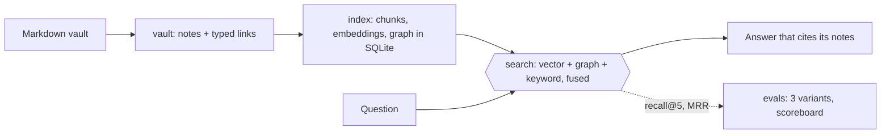

# Graph RAG over a Markdown vault

A vault of Markdown notes becomes a typed knowledge graph. Questions are answered with hybrid
search (the graph plus embeddings), every sentence of an answer cites the note it came from, and an
evaluation measures what the graph adds over vector search alone.

> **Status: in development.** The skeleton, the contracts and CI are in place; the vault, the
> search, the app and the scoreboard come next. Numbers will appear here only once they are measured.

## Quickstart

Node 24 and pnpm.

```bash
git clone https://github.com/leonfpontes/graph-rag-vault
cd graph-rag-vault && pnpm install
pnpm demo   # http://127.0.0.1:8787
```

## How it works



- **The vault** is a fictional company, Tarnwick Cycles: people, projects, decisions, meetings,
  documents and customers, linked by typed relations (`owner`, `decided_in`, `supersedes`…).
- **The search** runs in plain TypeScript, the same code in Node and in the browser, and says why
  each result came in: a vector match, a title, a keyword, or a link from another result.
- **The evaluation** compares three variants (vectors only, graph only, hybrid) on questions with
  known source notes.

## Repository

| Folder            | What it has                                                     |
| ----------------- | --------------------------------------------------------------- |
| `packages/vault`  | The note and link contract, and the Markdown parser             |
| `packages/index`  | The SQLite index: migrations, chunks, embeddings and the graph  |
| `packages/search` | Hybrid search, the same in Node and in the browser              |
| `packages/api`    | The local API and the server for the app and the demo           |
| `apps/web`        | The app on Atlas UI: Explore, Ask, Note and Evaluation          |
| `evals`           | Questions with expected sources, the metrics and the scoreboard |

## Development

| Command                  | Does                                                                |
| ------------------------ | ------------------------------------------------------------------- |
| `pnpm dev --port 5173`   | the web app with hot reload (the API from `pnpm serve`)             |
| `pnpm demo --port 8787`  | builds, then serves the app and the API on one port                 |
| `pnpm serve --port 8787` | the same server, rebuilding only the API                            |
| `pnpm check`             | types, lint, formatting, tests and build                            |
| `pnpm qa`                | `pnpm check`, then the end-to-end tests (`E2E_PORT` picks the port) |
| `pnpm test --coverage`   | the tests with the coverage floors, as CI runs them                 |
| `pnpm index`             | rebuilds the search index from the vault (downloads the model once) |
| `pnpm retrieval`         | recall@5 and MRR of the three variants on the tuning questions      |

Every server listens on 127.0.0.1. `--port` or the `PORT` variable picks the port; a busy port
stops the server with an error, it never moves to the next one.

Architecture: [docs/ARCHITECTURE.md](docs/ARCHITECTURE.md). Rules for AI agents:
[AGENTS.md](AGENTS.md). Changes: [CHANGELOG.md](CHANGELOG.md).

## License

[MIT](LICENSE). Built by [Leonardo Pontes](https://www.linkedin.com/in/leonardo-fonseca-pontes-465740103/).
Tarnwick Cycles and everyone in its vault are fictional.
