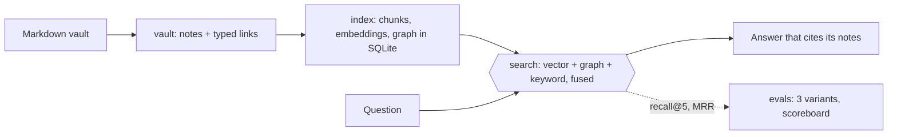

# Graph RAG over a Markdown vault

A vault of Markdown notes becomes a typed knowledge graph. Questions are answered with hybrid
search (the graph plus embeddings), every sentence of an answer cites the note it came from, and an
evaluation measures what the graph adds over vector search alone.

> **Status: in development.** The skeleton, the contracts and CI are in place; the vault, the
> search, the app and the scoreboard come next. Every number here is measured: [the scoreboard](evals/results/latest.md).

## Quickstart

Node 24 and pnpm.

```bash
git clone https://github.com/leonfpontes/graph-rag-vault
cd graph-rag-vault && pnpm install
pnpm demo   # http://127.0.0.1:8787
```

No key is needed: the search runs in the browser, and the 50 evaluation questions replay their
recorded answers. For written answers to new questions, copy `.env.example` to `.env.local`, put
your Anthropic key in `ANTHROPIC_API_KEY` and run `pnpm demo` again (each answer costs a fraction of
a cent; `--no-key` ignores the key).

## How it works



- **The vault** is a fictional company, Tarnwick Cycles: people, projects, decisions, meetings,
  documents and customers, linked by typed relations (`owner`, `decided_in`, `supersedes`…).
- **The search** runs in plain TypeScript, the same code in Node and in the browser, and says why
  each result came in: a vector match, a title, a keyword, or a link from another result.
- **The evaluation** compares three variants (vectors only, graph only, hybrid) on questions with
  known source notes.

## Scoreboard

40 questions never used for tuning, measured on 2026-11-27 ([full scoreboard](evals/results/latest.md)).
Answers by Claude Haiku 5.5, mean of 3 rounds.

| Variant      | Expected notes in the top 5 | MRR  | Answerable questions answered | Expected notes cited | Faithfulness |
| ------------ | --------------------------- | ---- | ----------------------------- | -------------------- | ------------ |
| Hybrid       | 91%                         | 0.87 | 96%                           | 84%                  | 95%          |
| Graph only   | 93%                         | 0.78 | 94%                           | 82%                  | 97%          |
| Vectors only | 73%                         | 0.73 | 73%                           | 62%                  | 98%          |

- **Search:** hybrid and graph only tie (2 points apart, under the 5-point tie line). Against
  vectors only, hybrid is +18 points, most of it on multi-hop questions (79% against 50%); against
  the strongest embedding model we tried for vectors only (arctic-embed-xs, 78%), +13.
- **One runtime for the vectors:** the index, the local API and the browser all run the model on
  onnxruntime-web (WebAssembly), so a question asked in the demo gets the same vector as in the
  evaluation (cosine > 0.9999).
- **Faithfulness** comes from an automatic judge (Claude Haiku 5.5), sentence by sentence, against
  the passages each sentence cites.
- **Checked by a person (Leonardo Pontes)** on a stratified sample of 10 answers (half from those
  with a sentence the judge did not fully support). **Reviewed not blind: agreed with the judge on
  18 of 18 sentences.** **Labelled blind, without the judge's verdicts: agreed on 2 of 3
  sentences** (the answers that changed in the index rebuild); on the third the judge said partial
  and the person supported, the same direction as the second judge. No kappa: the review saw the
  verdicts, and 3 blind sentences are too few for one.
- **Agreement between two automatic judges:** Claude Opus 5.5, blind, on the same 21 sentences:
  76%, Cohen's kappa 0.00. All 5 disagreements go the same way: the main judge said partial, the
  second judge said supported, so the faithfulness above is a conservative estimate. Kappa says
  little here: the second judge marked all 21 sentences supported, and with one judge on a single
  label, kappa is 0 whatever the other does. The main judge stays Claude Haiku 5.5.
- **Cost:** $0.17 for all recorded answers and their judgments (370); the index rebuild asked again
  the 111 whose search notes changed, for $0.04; the second judge cost $0.11.

## Repository

| Folder            | What it has                                                     |
| ----------------- | --------------------------------------------------------------- |
| `packages/vault`  | The note and link contract, and the Markdown parser             |
| `packages/index`  | The SQLite index: migrations, chunks, embeddings and the graph  |
| `packages/search` | Hybrid search, the same in Node and in the browser              |
| `packages/client` | What the app reads: the static demo in the browser, the routes  |
| `packages/api`    | The local API and the server for the app and the demo           |
| `apps/web`        | The app on Atlas UI: Explore, Ask, Note and Evaluation          |
| `evals`           | Questions with expected sources, the metrics and the scoreboard |

## Development

| Command                  | Does                                                                |
| ------------------------ | ------------------------------------------------------------------- |
| `pnpm dev --port 5173`   | the web app with hot reload (the API from `pnpm serve`)             |
| `pnpm demo --port 8787`  | builds, then serves the app and the API on one port                 |
| `pnpm serve --port 8787` | the same server, rebuilding only the API                            |
| `pnpm check`             | types, lint, formatting, tests and build                            |
| `pnpm qa`                | `pnpm check`, then the end-to-end tests (`E2E_PORT` picks the port) |
| `pnpm test --coverage`   | the tests with the coverage floors, as CI runs them                 |
| `pnpm index`             | rebuilds the search index from the vault (downloads the model once) |
| `pnpm retrieval`         | recall@5 and MRR of the three variants on the tuning questions      |

Every server listens on 127.0.0.1. `--port` or the `PORT` variable picks the port; a busy port
stops the server with an error, it never moves to the next one.

Architecture: [docs/ARCHITECTURE.md](docs/ARCHITECTURE.md). Rules for AI agents:
[AGENTS.md](AGENTS.md). Changes: [CHANGELOG.md](CHANGELOG.md).

## License

[MIT](LICENSE). Built by [Leonardo Pontes](https://www.linkedin.com/in/leonardo-fonseca-pontes-465740103/).
Tarnwick Cycles and everyone in its vault are fictional.
