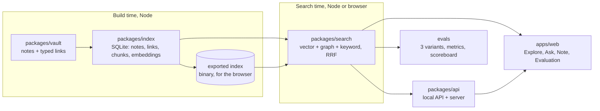

# Architecture

One pnpm monorepo in TypeScript (strict), Node 24. Each package owns one step from the vault to the
answer; the contracts between them live in code, in the package that owns them.

## Packages

| Package             | Folder            | Owns                                                                     |
| ------------------- | ----------------- | ------------------------------------------------------------------------ |
| `@graph-rag/vault`  | `packages/vault`  | `Note`, `Link`, the 6 note types and the 7 relations; the parser         |
| `@graph-rag/index`  | `packages/index`  | `openIndex`, reversible `migrate` (PRAGMA `user_version`), the schema    |
| `@graph-rag/search` | `packages/search` | `SearchHit` with `Reason[]`, vectors as BLOBs, brute-force `topK`, `rrf` |
| `@graph-rag/api`    | `packages/api`    | The fetch handler (`createApi`) and the Node server (`serveHttp`)        |
| `@graph-rag/web`    | `apps/web`        | The app on Atlas UI (`@leonfpontes/atlas-ui` from npm)                   |
| `@graph-rag/evals`  | `evals`           | `Question` (kind, split, expected sources), `recallAtK`, MRR, mean ± sd  |

## Contracts

- **Notes** (`packages/vault`): a note has `id` (lowercase words with hyphens), `type` (`person`,
  `project`, `decision`, `meeting`, `document`, `customer`), `title`, `aliases`, `created` and
  `updated` (ISO dates), `status`, `path` and `body`. Typed relations come from frontmatter fields
  of the same name (`owner`, `attendees`, `decided_in`, `customer`, `supersedes`, `reports_to`);
  a wikilink in the body is a `mentions` link. `supersedes` points from the newer note to the older.
- **Index** (`packages/index`): SQLite through `node:sqlite`. Migrations are numbered 1..n, each with
  an `up` and a `down`, one transaction each; a failing one rolls back. Embeddings are Float32
  vectors stored as little-endian BLOBs (`toBlob`/`fromBlob` in `packages/search`).
- **Chunks** (`packages/index`, `chunkNote`): sections follow the headings; paragraphs are packed
  up to 200 approximate tokens (prefix included), with no overlap; a long paragraph splits by
  sentence, then by word. A chunk has `id` (`<noteId>#<ord>`), `noteId`, `ord`, `heading`, `text`
  (the Markdown as written, for the app) and `embedText` (`Title › Heading`, a blank line, then the
  text with wikilinks as words: what gets embedded). A note with no body has no chunks.
- **Search** (`packages/search`): variants `vector`, `graph` and `hybrid`. Every hit carries the
  reasons it came in: `vector` (similarity), `title` (matched alias), `keyword` (terms), `link`
  (from, relation, 1 or 2 hops) or `same-project`. Lists are fused with reciprocal rank fusion
  (k = 60). The package imports nothing from Node.
- **API** (`packages/api`): read-only, GET and HEAD; other methods get 405. Errors are JSON
  `{ "error": "…" }` and never echo the request. `GET /api/meta` → `{ name, mode }`, where `mode` is
  `demo` (never calls a model) or `local`. The search, note, graph and answer routes come with the
  API story.
- **Evaluation** (`evals`): questions of 4 kinds (`fact`, `multi-hop`, `temporal`, `unanswerable`)
  in 3 splits (`probe` and `dev` tune, `test` scores). recall@5 and MRR leave unanswerable
  questions out of the mean. Deviation across rounds is the sample standard deviation.

## Servers and ports

Every server listens on 127.0.0.1 on the port it is given (`--port` or `PORT`) and fails on a busy
port. `pnpm demo` and `pnpm serve` default to 8787, `pnpm dev` to 5173 (it proxies `/api` to
`GRAPH_RAG_API`, default `http://127.0.0.1:8787`), and the end-to-end tests to `E2E_PORT` (4173).

## Decisions

- [ADR 0001](adr/0001-pnpm-typescript-atlas.md): one pnpm monorepo in TypeScript, Atlas UI from npm.
- [ADR 0002](adr/0002-sqlite-brute-force-vectors-and-static-demo.md): SQLite with brute-force
  vectors, and a static demo that searches in the browser.
