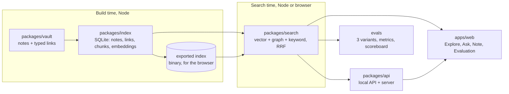

# Architecture

One pnpm monorepo in TypeScript (strict), Node 24. Each package owns one step from the vault to the
answer; the contracts between them live in code, in the package that owns them.

## Packages

| Package                 | Folder                | Owns                                                                                      |
| ----------------------- | --------------------- | ----------------------------------------------------------------------------------------- |
| `@graph-rag/vault`      | `packages/vault`      | `Note`, `Link`, the 6 note types and the 7 relations; the parser; the world               |
| `@graph-rag/index`      | `packages/index`      | `openIndex`, reversible `migrate` (PRAGMA `user_version`), the schema                     |
| `@graph-rag/search`     | `packages/search`     | `SearchHit` with `Reason[]`, vectors as BLOBs, brute-force `topK`, `rrf`                  |
| `@graph-rag/embeddings` | `packages/embeddings` | `createEmbedder`: the pinned model, query prefix, token counter (Node and browser)        |
| `@graph-rag/answer`     | `packages/answer`     | `answerQuestion`: cited, quoted sentences, removed ones, "I don't know"; the model client |
| `@graph-rag/api`        | `packages/api`        | The fetch handler (`createApi`) and the Node server (`serveHttp`)                         |
| `@graph-rag/web`        | `apps/web`            | The app on Atlas UI (`@leonfpontes/atlas-ui` from npm)                                    |
| `@graph-rag/evals`      | `evals`               | `Question` (kind, split, expected sources), traps, `recallAtK`, MRR, mean ± sd            |

## Contracts

- **Notes** (`packages/vault`): a note has `id` (lowercase words with hyphens), `type` (`person`,
  `project`, `decision`, `meeting`, `document`, `customer`), `title`, `aliases`, `created` and
  `updated` (ISO dates), `status`, `path` and `body`. Typed relations come from frontmatter fields
  of the same name (`owner`, `attendees`, `decided_in`, `customer`, `supersedes`, `reports_to`);
  a wikilink in the body is a `mentions` link. `supersedes` points from the newer note to the older.
  A relation field holds a wikilink (`owner: "[[per-maya-okafor]]"`) or a list of them.
  `parseNote(path, text)` reads one note with no Node APIs and throws a `NoteError` listing every
  problem; `readVault(dir)` (`@graph-rag/vault/node`) reads a folder and reports bad notes, duplicate
  ids and broken links instead of throwing.
- **Example vault** (`examples/tarnwick`): Tarnwick Cycles, an invented bicycle maker. `world.yaml`
  is the source of truth: 207 people, projects, customers, meetings, decisions and documents, with
  stale and replaced notes on purpose (some replaced notes still say `current`, so recency has to
  come from the dates). `pnpm --filter @graph-rag/vault generate` renders one note per entity into
  `vault/<type folder>/<id>.md`; a test compares the files with the world byte by byte and reads
  every link back. The generated notes are not formatted by Prettier.
- **Index** (`packages/index`): SQLite through `node:sqlite`. Migrations are numbered 1..n, each with
  an `up` and a `down`, one transaction each; a failing one rolls back. Embeddings are Float32
  vectors stored as little-endian BLOBs (`toBlob`/`fromBlob` in `packages/search`). Schema
  (`migrations.ts`, rules in CHECKs and foreign keys):

  | Table        | Holds                                                     | Keys and indexes                                    |
  | ------------ | --------------------------------------------------------- | --------------------------------------------------- |
  | `notes`      | one row per note, with `content_hash` to re-index changes | `id`; `path` unique; `(type, updated DESC)`         |
  | `aliases`    | the names a note answers to, `norm` lowercased            | `(note_id, norm)`; `norm` (graph entry point)       |
  | `links`      | typed edges; `dst` may be a note not written yet          | `(src, relation, dst)`; `(dst, relation)` backlinks |
  | `chunks`     | `chunkNote` output: `text` for the app, `embed_text`      | `id` = `<note_id>#<ord>`; `(note_id, ord)`          |
  | `chunks_fts` | FTS5 (porter) over `embed_text`, kept by triggers         | BM25 for the keyword list                           |
  | `embeddings` | one vector per chunk and model, `length = dim × 4`        | `(model, chunk_id)`                                 |

  Deleting a note deletes its aliases, outgoing links, chunks and their vectors.

- **Chunks** (`packages/index`, `chunkNote`): sections follow the headings; paragraphs are packed
  up to 200 approximate tokens (prefix included), with no overlap; a long paragraph splits by
  sentence, then by word. A chunk has `id` (`<noteId>#<ord>`), `noteId`, `ord`, `heading`, `text`
  (the Markdown as written, for the app) and `embedText` (`Title › Heading`, a blank line, then the
  text with wikilinks as words: what gets embedded). A note with no body has no chunks.
- **Embeddings** (`packages/embeddings`, ADR 0003): its own package, apart from the search, so the
  static demo loads the search alone and fetches the model only when a person asks a new question.
  No Node APIs (the Ask worker runs it in the browser); the model loader is injected, so tests need
  no network.
  `createEmbedder({ model?, batchSize?, cacheDir?, device?, load? }): Promise<Embedder>`, where
  `Embedder = { model, embedQuery(question), embedPassages(texts), countTokens(text) }`.
  `embedQuery` adds the model's query prefix, and `embedPassages` takes chunk `embedText` with no
  prefix and refuses a passage over `model.maxTokens`. Both return unit `Float32Array`s of
  `model.dims` (384). `EmbeddingModel` pins `id`, `revision`, `pooling`, `queryPrefix`, `dims` and
  `maxTokens`; `DEFAULT_EMBEDDING_MODEL` is the one the index and the browser share.
- **Ingestion** (`packages/index`, B2) wires them together. Each note goes through
  `chunkNote(note, { countTokens: embedder.countTokens })`, then
  `embedder.embedPassages(chunks.map((c) => c.embedText))`, then `toBlob`, into `embeddings` keyed
  by `(model, chunk_id)`. Only notes whose `content_hash` changed are re-chunked and re-embedded.
  At search time, `embedQuery(question)` goes to `topK` over the same model's vectors, in Node or in
  the browser.
- **Search** (`packages/search`): variants `vector`, `graph` and `hybrid`. Every hit carries the
  reasons it came in: `vector` (similarity), `title` (matched alias), `keyword` (terms), `link`
  (from, relation, 1 or 2 hops) or `same-project`. Lists are fused with reciprocal rank fusion
  (k = 60). The package imports nothing from Node.
- **Answer** (`packages/answer`, ADR 0004): `answerQuestion({ question, passages, provider })`, where a
  `Passage` is `{ chunkId, noteId, title, heading?, text, updated, status? }` (the search results,
  best first, at most 12 read). It returns `{ status: 'answered' | 'unknown', sentences, removed,
nearest, model, fallbackUsed, calls, usage, costMicros, promptVersion }`; each sentence carries
  `citations: { chunkId, noteId, quote }[]`, and each removed one a `reason`. Local mode only:
  `createAnthropicProvider({ apiKey })` reads no environment itself, the caller passes the key.
- **API** (`packages/api`): read-only, GET and HEAD; other methods get 405. Errors are JSON
  `{ "error": "…" }` and never echo the request. `GET /api/meta` → `{ name, mode }`, where `mode` is
  `demo` (never calls a model) or `local`. The search, note, graph and answer routes come with the
  API story.
- **Evaluation** (`evals`): questions of 4 kinds (`fact`, `multi-hop`, `temporal`, `unanswerable`)
  in 3 splits (`probe` and `dev` tune, `test` scores). recall@5 and MRR leave unanswerable
  questions out of the mean. Deviation across rounds is the sample standard deviation. The set
  lives in `evals/questions.yaml` (`loadQuestions`); each question lists its traps, and
  `checkQuestions` proves them from the vault: `bridge` (typed links from a note the question names
  to the answer; the notes past the start are not named), `supersedes` (a newer note replaces the
  one the question's words point at; `vocabulary: other` when it shares fewer words), `alias` (the
  question uses only an alias), `neighbour` (an unanswerable question on a covered topic, with
  patterns that must match no note) and `newest` (several unlinked notes answer at different dates;
  the newest wins). Every answerable question names `evidence`, text that must be in one of its
  expected sources. The set has 50 questions: 10 that may tune the search (`probe` and `dev`: 2
  fact, 4 multi-hop, 3 temporal, 1 unanswerable) and 40 for the scoreboard (`test`: 8, 14, 11 and
  7), with at least 12 two-hop questions in the test split. The test questions are written from the
  rules and the world, never checked against what a search returns.

## Servers and ports

Every server listens on 127.0.0.1 on the port it is given (`--port` or `PORT`) and fails on a busy
port. `pnpm demo` and `pnpm serve` default to 8787, `pnpm dev` to 5173 (it proxies `/api` to
`GRAPH_RAG_API`, default `http://127.0.0.1:8787`), and the end-to-end tests to `E2E_PORT` (4173).

## Decisions

- [ADR 0001](adr/0001-pnpm-typescript-atlas.md): one pnpm monorepo in TypeScript, Atlas UI from npm.
- [ADR 0002](adr/0002-sqlite-brute-force-vectors-and-static-demo.md): SQLite with brute-force
  vectors, and a static demo that searches in the browser.
- [ADR 0004](adr/0004-answers-cite-and-quote.md): answers on Claude Haiku 5.5 that cite and quote
  their passages, checked by code; a sentence without a source is removed.
- [ADR 0003](adr/0003-local-embedding-model.md): one open embedding model (bge-small-en-v1.5),
  pinned to a revision, the same in Node and in the browser.
