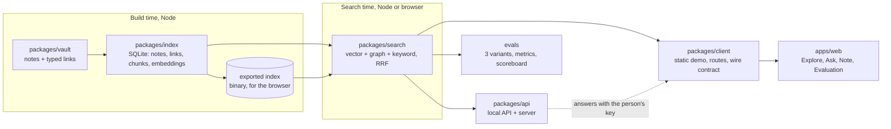

# Architecture

One pnpm monorepo in TypeScript (strict), Node 24. Each package owns one step from the vault to the
answer; the contracts between them live in code, in the package that owns them.

## Packages

| Package                 | Folder                | Owns                                                                                                    |
| ----------------------- | --------------------- | ------------------------------------------------------------------------------------------------------- |
| `@graph-rag/vault`      | `packages/vault`      | `Note`, `Link`, the 6 note types and the 7 relations; the parser; the world                             |
| `@graph-rag/index`      | `packages/index`      | `openIndex`, reversible `migrate` (PRAGMA `user_version`), the schema                                   |
| `@graph-rag/search`     | `packages/search`     | `SearchHit` with `Reason[]`, vectors as BLOBs, brute-force `topK`, `rrf`                                |
| `@graph-rag/embeddings` | `packages/embeddings` | `createEmbedder`: the pinned model on one runtime (WASM), query prefix, token counter; `/node` for Node |
| `@graph-rag/answer`     | `packages/answer`     | `answerQuestion`: cited, quoted sentences, removed ones, "I don't know"; the model client               |
| `@graph-rag/client`     | `packages/client`     | `loadDemo` (the static demo in the browser), the app's routes, the API's wire types                     |
| `@graph-rag/api`        | `packages/api`        | The fetch handler (`createApi`) and the Node server (`serveHttp`)                                       |
| `@graph-rag/web`        | `apps/web`            | The app on Atlas UI (`@leonfpontes/atlas-ui` from npm)                                                  |
| `@graph-rag/evals`      | `evals`               | `Question` (kind, split, expected sources), traps, `recallAtK`, MRR, mean ± sd                          |

## Contracts

- **Notes** (`packages/vault`): a note has `id` (lowercase words with hyphens), `type` (`person`,
  `project`, `decision`, `meeting`, `document`, `customer`), `title`, `aliases`, `created` and
  `updated` (ISO dates), `status`, `path` and `body`. Typed relations come from frontmatter fields
  of the same name (`owner`, `attendees`, `decided_in`, `customer`, `supersedes`, `reports_to`);
  a wikilink in the body is a `mentions` link. `supersedes` points from the newer note to the older.
  A relation field holds a wikilink (`owner: "[[per-maya-okafor]]"`) or a list of them.
  `parseNote(path, text)` reads one note with no Node APIs and throws a `NoteError` listing every
  problem; `readVault(dir)` (`@graph-rag/vault/node`) reads a folder and reports bad notes, duplicate
  ids and broken links instead of throwing.
- **Example vault** (`examples/tarnwick`): Tarnwick Cycles, an invented bicycle maker. `world.yaml`
  is the source of truth: 207 people, projects, customers, meetings, decisions and documents, with
  stale and replaced notes on purpose (some replaced notes still say `current`, so recency has to
  come from the dates). `pnpm --filter @graph-rag/vault generate` renders one note per entity into
  `vault/<type folder>/<id>.md`; a test compares the files with the world byte by byte and reads
  every link back. The generated notes are not formatted by Prettier.
- **Index** (`packages/index`): SQLite through `node:sqlite`. Migrations are numbered 1..n, each with
  an `up` and a `down`, one transaction each; a failing one rolls back. Embeddings are Float32
  vectors stored as little-endian BLOBs (`toBlob`/`fromBlob` in `packages/search`). Schema
  (`migrations.ts`, rules in CHECKs and foreign keys):

  | Table        | Holds                                                     | Keys and indexes                                    |
  | ------------ | --------------------------------------------------------- | --------------------------------------------------- |
  | `notes`      | one row per note, with `content_hash` to re-index changes | `id`; `path` unique; `(type, updated DESC)`         |
  | `aliases`    | the names a note answers to, `norm` lowercased            | `(note_id, norm)`; `norm` (graph entry point)       |
  | `links`      | typed edges; `dst` may be a note not written yet          | `(src, relation, dst)`; `(dst, relation)` backlinks |
  | `chunks`     | `chunkNote` output: `text` for the app, `embed_text`      | `id` = `<note_id>#<ord>`; `(note_id, ord)`          |
  | `chunks_fts` | FTS5 (porter) over `embed_text`, kept by triggers         | BM25 for the keyword list                           |
  | `embeddings` | one vector per chunk and model, `length = dim × 4`        | `(model, chunk_id)`                                 |

  Deleting a note deletes its aliases, outgoing links, chunks and their vectors.

- **Chunks** (`packages/index`, `chunkNote`): sections follow the headings; paragraphs are packed
  up to 200 approximate tokens (prefix included), with no overlap; a long paragraph splits by
  sentence, then by word. A chunk has `id` (`<noteId>#<ord>`), `noteId`, `ord`, `heading`, `text`
  (the Markdown as written, for the app) and `embedText` (`Title › Heading`, a blank line, then the
  text with wikilinks as words: what gets embedded). A note with no body has no chunks.
- **Embeddings** (`packages/embeddings`, ADR 0003): its own package, apart from the search, so the
  static demo loads the search alone and fetches the model only when a person asks a new question.
  No Node APIs in the main entry (the Ask worker runs it in the browser); the model loader is
  injected, so tests need no network. **One runtime:** the vectors always come from
  onnxruntime-web on WebAssembly (`EMBEDDING_RUNTIME`). In the browser, transformers.js runs it; in
  Node, `@graph-rag/embeddings/node` gives the same `createEmbedder` with the tokenizer from
  transformers.js and the ONNX file run by onnxruntime-web, because transformers.js in Node only
  offers onnxruntime-node, whose 8-bit kernels give other vectors (cosine 0.996). The index, the
  local API and the evaluation import from `/node`. Passages go one per call (`batchSize` 1): the
  8-bit model quantizes activations with one scale per call, so a batch would change the vectors.
  `createEmbedder({ model?, batchSize?, cacheDir?, device?, load? }): Promise<Embedder>`, where
  `Embedder = { model, runtime, embedQuery(question), embedPassages(texts), countTokens(text) }`.
  `embedQuery` adds the model's query prefix, and `embedPassages` takes chunk `embedText` with no
  prefix and refuses a passage over `model.maxTokens`. Both return unit `Float32Array`s of
  `model.dims` (384). `EmbeddingModel` pins `id`, `revision`, `pooling`, `queryPrefix`, `dims` and
  `maxTokens`; `DEFAULT_EMBEDDING_MODEL` is the one the index and the browser share.
- **Ingestion** (`packages/index`, `ingest(db, notes, embedder)`): every note is chunked on every
  run (cheap); only chunks whose embedded text is new or changed, or that have no vector for this
  model and runtime, go to `embedder.embedPassages`, stored with `toBlob` in `embeddings` keyed by
  `(model, chunk_id)`, where `model` is `vectorKey(model id, runtime)`: vectors of two runtimes are
  never mixed. The runtime is part of the index's source hash. Notes whose `content_hash` didn't change keep their rows; removed notes take
  their links, chunks and vectors with them. The model runs before any write, and one transaction
  writes everything. Chunks are cut with the default token estimate, so a test can rebuild them
  with no model.
- **Index file** (`apps/web/public/data/index.bin`, `encodeIndex`/`decodeIndex`): `pnpm index`
  ingests into `.graph-rag/index.sqlite` and exports a `SearchIndex`: notes, links between existing
  notes, chunks, one unit vector per chunk and the 50 recorded questions with their vectors, plus a
  `sourceHash` of the vault, the questions, the chunker and the model. A test fails when the file is
  behind (`pnpm index` fixes it); `pnpm index --check` says the same with no model.
- **Search** (`packages/search`, ADR 0005): `createSearch(index, weights?)` →
  `search({ question, variant, queryVector?, k? })` → `SearchHit[]` (`noteId`, best `chunkId`,
  `score`, `reasons`). Variants: `vector`, `graph` (no embedding needed) and `hybrid`. Reasons:
  `vector` (similarity, chunk), `title` (matched name), `keyword` (terms, chunk), `link` (from,
  relation, direction, 1 or 2 hops), `supersedes` (older note), `recency` (factor) and `stale`
  (status, replacing note, factor). Entry lists are fused by weighted RRF, then scores spread along
  typed links. BM25 is in TypeScript, so Node and the browser rank the same. `DEFAULT_WEIGHTS` is
  tuned on probe and dev only. The package imports nothing from Node.
- **Retrieval scores** (`evals`, `retrievalReport`, `pnpm retrieval`): recall@5 and MRR per
  variant and kind, from the recorded question vectors in the index file (no model, no cost).
  Custom weights are refused on the test split.
- **Answer** (`packages/answer`, ADR 0004): `answerQuestion({ question, passages, provider })`, where a
  `Passage` is `{ chunkId, noteId, title, heading?, text, updated, status? }` (the search results,
  best first, at most 15 read; `passagesFromHits` builds them from search hits: the chunks of the top 5 notes and a "Links" passage per note that words its typed links and aliases). It returns `{ status: 'answered' | 'unknown', sentences, removed,
nearest, model, fallbackUsed, calls, usage, costMicros, promptVersion }`; each sentence carries
  `citations: { chunkId, noteId, quote }[]`, and each removed one a `reason`. Local mode only:
  `createAnthropicProvider({ apiKey })` reads no environment itself, the caller passes the key.
  The browser imports `@graph-rag/answer/passages` (the passages and the answer types, no Node and
  no model client), so the app shows the text behind a citation exactly as the answer read it.
- **Client** (`packages/client`, for the app; the screens build on it): runs in the browser, no
  Node. `loadDemo({ base = '/data/', api = '/api', fetch? })` → `Demo`, after loading
  `/data/index.bin`, `/data/latest.json` and `/data/questions.json` (and, right after, off the first
  search's path, `/data/answers.json`). The demo's first search answers in under 2 s
  (`e2e/demo.e2e.ts`).

  | Member                                                          | Gives                                                                                                                                                                                                          |
  | --------------------------------------------------------------- | -------------------------------------------------------------------------------------------------------------------------------------------------------------------------------------------------------------- |
  | `mode`                                                          | `static` (public site, no API), `demo` (local server, no key) or `local` (local server with the person's key)                                                                                                  |
  | `scoreboard`                                                    | `latest.json` as it is (`Scoreboard`): every number on screen comes from here, none is written by hand                                                                                                         |
  | `questions`, `findQuestion(idOrText)`                           | the 50 `RecordedQuestion`s (`id`, `kind`, `split`, `question`, `expectedSources`, `traps`); found by id (`q-011`) or by text, case and punctuation ignored                                                     |
  | `search({ question, variant = 'hybrid', queryVector?, k = 5 })` | `SearchOutcome { question, variant, ran, hits, recorded?, ms }`. A recorded question uses its recorded vector; a new one needs `queryVector` from the Ask worker, and without it `ran` is `graph`              |
  | `answer({ …search options, live?, signal? })`                   | `AnswerOutcome`: `recorded` (round 1 of that variant from `answers.json`, at once, no model), `live` (POST /api/answer, local mode only) or `needs-key` (the search, plus `commands`: `LOCAL_ANSWER_COMMANDS`) |
  | `recordedAnswer(id, variant?)`                                  | the recorded answer, if any (hybrid for all 50 questions; vector and graph for the 40 test ones)                                                                                                               |
  | `note(id)`                                                      | `NoteView { note, chunks (Markdown, in order), links (both ways, typed), replacedBy? }`, or undefined                                                                                                          |
  | `graph()`                                                       | `GraphView { nodes (id, type, title, status, updated, degree), links }`                                                                                                                                        |
  | `passageText(id)`, `passages(hits)`                             | the text behind a citation (`<noteId>#<ord>` or `<noteId>#links`); the passages an answer reads                                                                                                                |

  A recorded answer read the top 5 notes the browser finds for its question (test: every one of the
  130). The live answer fails with `ApiRequestError { status, message }`, a message the app can
  show. **Routes** (`matchRoute`, `paths`): `/` How it works, `/explore` (`?focus=<note>`), `/ask`
  (`?q=<question id or text>`), `/evaluation`, `/notes/<id>` (`NOTE_ID`: lowercase letters, digits,
  hyphens); anything else is `not-found`. The local server and `vercel.json` follow the same table
  (tests compare them).

- **App** (`apps/web`, design in [DESIGN.md](DESIGN.md)): one router over `matchRoute`, one `loadDemo`
  for every screen. State that can be shared is in the query string: Explore `?focus=<note>`,
  `?cluster=<project>`, `?view=3d|2d|list|map`; Ask `?q=<question id or text>`,
  `?variant=vector|graph` (hybrid by default) and `?draft=` (text in the box, not asked yet). The 3D
  view is Three.js in its own chunk, loaded when shown. A typed question is embedded in a Web Worker
  (`apps/web/src/ask/embed.worker.ts`): `createEmbedder({ device: 'wasm' })`, the same model, revision,
  8-bit weights and query prefix as the index, on one WASM thread. The ONNX runtime's files are served
  by the site (no CDN); the weights come from Hugging Face at the pinned revision and stay in the
  browser's Cache API. `window.graphRag.embedQuery` exposes the same call: `e2e/embed-parity.e2e.ts`
  checks that the browser's vectors match the index's (cosine > 0.999) and give the same top 5 in the
  three variants for the 50 recorded questions. In local mode, the server embeds the question itself.
- **Data files** (`apps/web/build-plugins.ts`): `/data/latest.json` and `/data/answers.json` are
  `evals/results/*.json` byte for byte, and `/data/questions.json` is `evals/questions.yaml` with
  the fields above. A Vite plugin reads them from the repository on each `pnpm dev` request and on
  each build: no copy is committed, so none can fall behind the scoreboard. `index.bin` is in
  `apps/web/public/data/`.
- **API** (`packages/api`, local only: `pnpm demo` and `pnpm serve`; the public site has none).
  Errors are JSON `{ "error": "…" }` and never echo the request. Every request must name a loopback
  `Host` (`127.0.0.1`, `localhost`, `[::1]`, any port), or it gets 403: a page that rebinds its
  domain to 127.0.0.1 gets nothing.

  | Route                                   | Answer                                                                                                                                                                                                              |
  | --------------------------------------- | ------------------------------------------------------------------------------------------------------------------------------------------------------------------------------------------------------------------- |
  | `GET /api/meta`                         | `ApiMeta { name, mode }`: `local` with a key, `demo` without                                                                                                                                                        |
  | `GET /api/search?q=&variant=hybrid&k=5` | `{ question, variant, ran, hits }`; the recorded vector for a recorded question, else the embedding model (loaded on first use), else `ran: graph`. 400: no `q`, over 500 characters, unknown variant, `k` not 1–50 |
  | `GET /api/notes/<id>`                   | `NoteView`; 404 for an unknown id                                                                                                                                                                                   |
  | `GET /api/graph`                        | `GraphView`                                                                                                                                                                                                         |
  | `POST /api/answer`                      | body `AnswerRequest { question, variant? }` → `AnswerResponse { question, variant, hits (10), answer: AnswerResult }`; the answer reads `passagesFromHits` of the top 5 notes, as the evaluation does               |

  `POST /api/answer` spends the person's key, so: JSON only (415 otherwise, so a plain form can't
  post), no `Origin` or this server's own (403 otherwise, and for `Sec-Fetch-Site: cross-site`),
  body up to 8 KB counted while it arrives, with or without `Content-Length` (413), one answer at a
  time (429), 503 without a key (with how to add one), 502 when the model fails (the reason goes to
  the server log only). The key comes from `ANTHROPIC_API_KEY` or `.env.local`, is never printed,
  and `--no-key` keeps it unread. The other routes are GET and HEAD only (405 with `Allow`).

- **Evaluation** (`evals`): questions of 4 kinds (`fact`, `multi-hop`, `temporal`, `unanswerable`)
  in 3 splits (`probe` and `dev` tune, `test` scores). recall@5 and MRR leave unanswerable
  questions out of the mean. Deviation across rounds is the sample standard deviation. The set
  lives in `evals/questions.yaml` (`loadQuestions`); each question lists its traps, and
  `checkQuestions` proves them from the vault: `bridge` (typed links from a note the question names
  to the answer; the notes past the start are not named), `supersedes` (a newer note replaces the
  one the question's words point at; `vocabulary: other` when it shares fewer words), `alias` (the
  question uses only an alias), `neighbour` (an unanswerable question on a covered topic, with
  patterns that must match no note) and `newest` (several unlinked notes answer at different dates;
  the newest wins). Every answerable question names `evidence`, text that must be in one of its
  expected sources. The set has 50 questions: 10 that may tune the search (`probe` and `dev`: 2
  fact, 4 multi-hop, 3 temporal, 1 unanswerable) and 40 for the scoreboard (`test`: 8, 14, 11 and
  7), with at least 12 two-hop questions in the test split. The test questions are written from the
  rules and the world, never checked against what a search returns.
- **Scoreboard** (`pnpm eval`, `evals/src/evaluate.ts`): on the 40 test questions, recall@5 and MRR
  of the three variants in one round, plus the vector-only baseline with each candidate embedding
  model (re-embedded locally, no cost). Then, for each question, variant and round (3 by default),
  `answerQuestion` reads `passagesFromHits` of that variant and the judge (`judgeAnswer`, prompt
  `evals/prompts/judge.md`, output through `submit_verdicts`) labels each kept sentence `supported`,
  `partial` or `unsupported` against the passages it cites. Per variant, mean ± sample deviation
  over rounds: faithfulness (1 / 0.5 / 0), citations kept by the quote check, sentences removed,
  "I don't know" on unanswerable questions, answered on answerable ones, expected notes cited, cost
  and latency. A hard cap (default $5) is reserved per job at the fallback's worst case. The run
  writes `evals/results/latest.json` (the source the README, the site and the share images read),
  `latest.md` and `answers.json` (every answer, plus one hybrid answer per tuning question for the
  demo to replay). A run without the test split is a rehearsal (`rehearsal.*`, not committed) and
  never answers a test question. `pnpm eval --sheet <file>` picks about 10 round-1 answers for the
  judge check (`judge-sample.json`, the judge hidden on the sheet); `human-labels.json` with the
  person's labels (`"blind": false` for a review that saw the verdicts: no kappa) and
  `pnpm eval --report` add the check to the scoreboard. `pnpm eval --second-judge` labels the same
  sample blind with Claude Opus 5.5 (`second-judge.json`, `secondJudge` in `latest.json`): agreement
  between two automatic judges, never a human check.

## Servers and ports

Every server listens on 127.0.0.1 on the port it is given (`--port` or `PORT`) and fails on a busy
port. `pnpm demo` and `pnpm serve` default to 8787, `pnpm dev` to 5173 (it proxies `/api` to
`GRAPH_RAG_API`, default `http://127.0.0.1:8787`), and the end-to-end tests to `E2E_PORT` (4173,
started with `--no-key`). The local server opens the app on its routes and answers any other path
with the app and status 404, as Vercel does.

## Deploy (static, Vercel)

`vercel.json`: `pnpm install --frozen-lockfile`, then `pnpm --filter @graph-rag/web build` and a
copy of `index.html` as `404.html` (Vercel serves it with status 404, so an unknown path is a real
404 that shows the app's 404 page). Rewrites only for the app's routes. No functions: the search,
the recorded answers and the scoreboard all run from `apps/web/dist`. Project settings: `SITE_URL`
(the public origin, for `og:url` and `og:image`; without it a production build falls back to
`VERCEL_PROJECT_PRODUCTION_URL`, and fails with neither) and `ENABLE_EXPERIMENTAL_COREPACK=1` (pnpm
11 from `packageManager`). The OG image is `apps/web/public/og.png`, 1200 × 630, made from the
scoreboard with the share pieces by `pnpm share-images` (`apps/web/scripts/share-images.mjs`: the
built app on its own port, `/share?record`, a screenshot of each piece, and `docs/share.values.json`
with the values they show, which `apps/web/src/lib/share.test.tsx` compares with the sources).
`pnpm record-demo` records the README GIF (20 s, 960 px) and video (60 s, 1280 × 720, H.264) frame by
frame from `/demo?record`, a stage that is a pure function of the clock (`window.__setTime`), with
ffmpeg; the captions are drawn in the frame, written as WebVTT and kept in
`docs/media/graph-rag-demo.numbers.json` (`demo-script.test.tsx`). `pnpm readme` rewrites the README
scoreboard from `latest.json` (`apps/web/src/lib/readme.ts`; `apps/web/src/lib/readme.test.ts` fails
when it is behind).

## Decisions

- [ADR 0001](adr/0001-pnpm-typescript-atlas.md): one pnpm monorepo in TypeScript, Atlas UI from npm.
- [ADR 0002](adr/0002-sqlite-brute-force-vectors-and-static-demo.md): SQLite with brute-force
  vectors, and a static demo that searches in the browser.
- [ADR 0004](adr/0004-answers-cite-and-quote.md): answers on Claude Haiku 5.5 that cite and quote
  their passages, checked by code; a sentence without a source is removed.
- [ADR 0003](adr/0003-local-embedding-model.md): one open embedding model (bge-small-en-v1.5),
  pinned to a revision, the same in Node and in the browser.
- [ADR 0005](adr/0005-hybrid-search-score-propagation.md): hybrid search, fused entry lists and
  scores spread along typed links, tuned on probe and dev only.
- [ADR 0006](adr/0006-scoreboard-and-judge.md): the scoreboard on the 40 test questions, 3 rounds
  of answers, a faithfulness judge, a person's review and a second automatic judge with Cohen's kappa.
